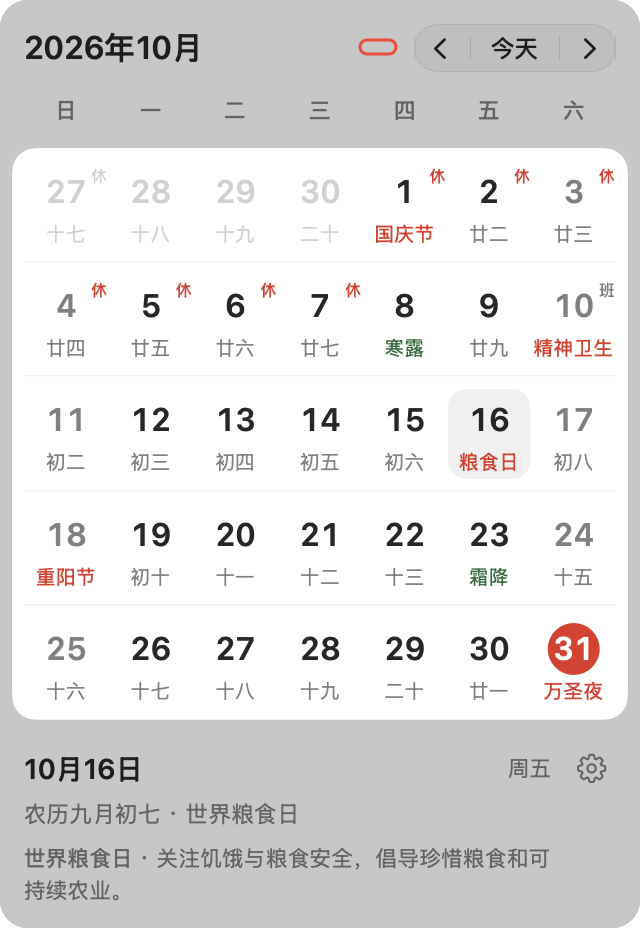
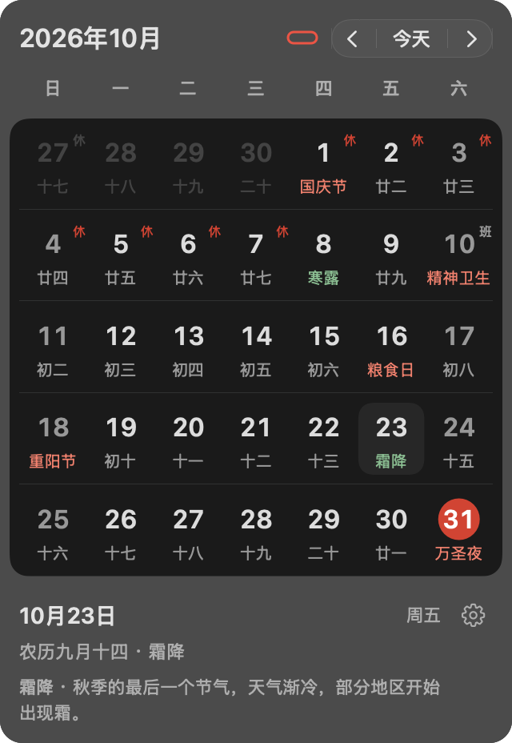
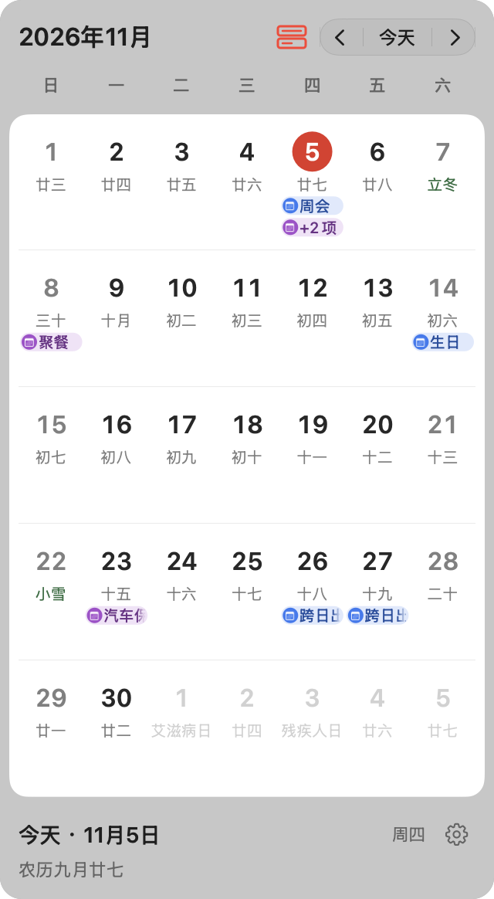

# 日序 DayOrder

日序是一款使用 Swift 构建的原生 macOS 菜单栏日历，支持公历、农历、二十四节气、节日和中国大陆放假调休查询。可选读取系统日历日程。日期数据内置，可离线使用；查看个人日程时才需要系统日历权限。

[快速开始](#快速开始) · [核心功能](#核心功能) · [界面预览](#界面预览) · [开发与贡献](#开发与贡献)

## 快速开始

安装使用：从 [GitHub Releases](https://github.com/hygao1024/day-order/releases) 下载 ARM64 的 DMG，打开后将应用拖入“应用程序”。要求 Apple 芯片 Mac 和 macOS 14+；预发布版本不进入自动更新渠道。

从源码构建：**Apple 芯片 Mac、macOS 14+、Swift 6.0+**，安装 Xcode 或 Command Line Tools（命令行开发工具）。首次构建需要联网下载 Sparkle（自动更新框架）。

在仓库根目录执行：

```sh
./scripts/build-app.sh
open build/DayOrder.app
```

启动后，点击菜单栏中的日期或图标即可打开日历。可将 `build/DayOrder.app` 拖入「应用程序」使用；应用不显示 Dock（程序坞）图标。需要登录 Mac 后自动启动时，在设置的「通用」分组开启「开机自启」。

构建产物仅支持 arm64 架构，采用本地临时签名，尚未经过 Apple 开发者签名与公证。开发运行方式和验证命令见 [AGENTS.md](AGENTS.md#构建与基础验证)。

## 核心功能

1. **农历与节气**：支持 1901–2100 年，显示农历日期、二十四节气和当天的节气介绍。
2. **节日与调休**：显示中国传统节日、公历节日、西方节日和精选世界日；通过「休／班」标记展示已收录的中国大陆放假与补班安排。
3. **月份与年份导航**：连续滚动浏览月份，支持箭头切月、年概览、输入年份跳转和返回今天。每次重新打开日历都会回到今天。
4. **显示偏好**：可配置菜单栏图标与日期、日期格式、每周起始日和节日分类；支持深浅色、跟随系统及毛玻璃效果开关，偏好自动保存。
5. **软件更新**：从本仓库的 GitHub Releases（版本发布）获取正式版本；可手动检查，或开启自动检查与自动下载并安装。更新清单和安装包均需通过签名校验。
6. **离线查询**：农历、节气、节日及介绍均可离线浏览。自动检查与自动安装默认关闭；手动更新放假安排、检查软件更新或启用自动检查时会联网。
7. **系统日程**：授权后在对应日期下显示系统日历事件，支持详细胶囊、精简横线、圆点与完全隐藏四档，颜色跟随事件所属日历。

## 界面预览

<table>
  <tr>
    <th width="50%">浅色月历</th>
    <th width="50%">深色月历</th>
  </tr>
  <tr>
    <td></td>
    <td></td>
  </tr>
</table>

系统日程的详细模式：



以上为实际应用视图快照，个人日程使用示例数据；桌面上的毛玻璃效果会随后方内容变化。

## 基本使用

- 点击菜单栏日期或图标展开日历，点击外部或按 Esc（退出键）收起。
- 点击日期查看详情，点击左上角年月进入年概览。红色圆圈表示今天，圆角底色表示选中的日期。
- 方向键移动一天或一周，Page Up / Page Down（上翻页／下翻页）切月，Home（起始键）返回今天。
- 点击日期详情右侧的齿轮打开设置；放假安排更新和退出应用的入口也位于设置中。

点击月份与“今天”之间的图标选择日程显示模式；默认隐藏，首次选择显示模式时请求系统日历权限。日程模式会保留，日期行按所需空间增高。

设置中的“软件更新”仅接收正式版本，不接收 alpha/beta 预发布版本。开启自动安装后，后台下载并在退出时安装；也可在更新窗口中选择立即安装并重启。首次升级到含自动更新功能的版本仍需手动安装。

## 数据来源与使用范围

农历与节气采用[香港天文台公历与农历日期对照表](https://www.hko.gov.hk/en/gts/time/conversion.htm)。菜单栏「今天」遵循设备所在时区，农历和节气按中国历法日期标注。节气介绍描述传统时令，不是当地天气预报。节日与世界日为精选内容，现代固定日期节日不追溯设立年份。

放假与调休数据来自按国务院公告整理的第三方项目 [holiday-cn](https://github.com/NateScarlet/holiday-cn)，内置 **2024–2026 年**安排。设置中的更新按钮会获取当前浏览年份及下一年的数据，成功后保存在本机；其他年份的可用性取决于上游发布情况，更新失败时保留已有有效数据。

**节日名称不等于放假安排，未标记「休／班」也不代表正常上班。** 应用只标注明确收录的安排，不补标所有普通周末。「放假安排未收录」或「翌年跨年安排未收录」表示信息不完整，放假安排请以官方公告为准。

系统日程仅供查看，不新增、修改或删除事件；内容仅保存在运行内存中，不上传到其他服务。账户与日历同步由系统负责。完整日期规则、日程权限与数据处理约定见[日历行为与数据参考](docs/calendar-reference.md)。

## 开发与贡献

开发前请阅读 [AGENTS.md](AGENTS.md)，其中包含协作约定、构建、基础验证和数据维护入口。可使用 Xcode 打开 `Package.swift`，或通过 `swift run DayOrder` 启动开发版本。

- [日历行为与数据参考](docs/calendar-reference.md)：界面交互、日期规则与数据边界。
- [界面验证参考](docs/verification.md)：真实应用截图、专项检查及其覆盖范围。
- [软件更新与发布](docs/app-updates.md)：更新开关、签名密钥、ARM64 打包与正式版本发布。
- [标签自动构建](docs/app-updates.md#标签自动构建)：推送版本标签后生成 macOS ARM64 安装包，在 Release 页面下载 DMG 或 ZIP。
- [Agent Notes（决策记录）规则](.agents/notes/README.md)：设计取舍的记录与维护方式。
