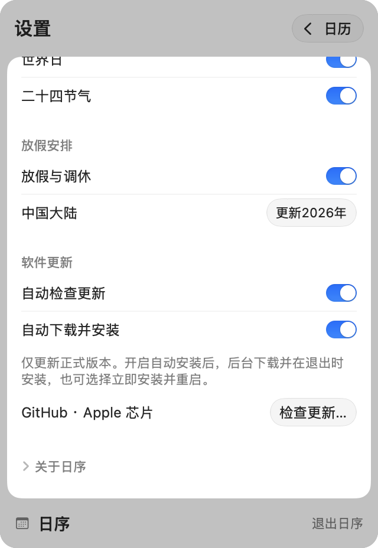
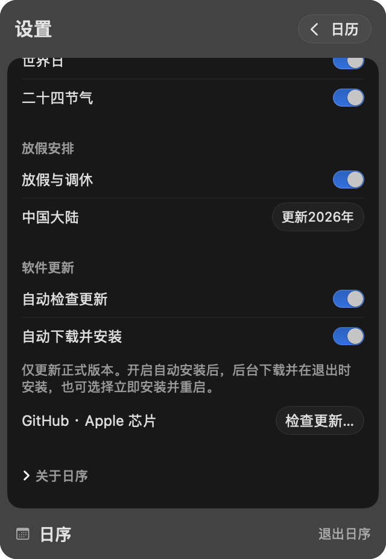

# 软件更新与发布

## 使用与联网范围

设置中的“软件更新”面向 Apple 芯片 Mac，使用 Sparkle 2.10.1。日历查询不依赖更新服务。自动检查和自动下载并安装默认关闭，偏好由 Sparkle 持久化到应用设置域。

- “检查更新…”始终允许手动检查，与自动检查开关独立；检查期间由框架防止重复发起，并提供取消、错误和重试界面。
- “自动检查更新”开启后由 Sparkle 调度，默认约每 24 小时检查。关闭时同时关闭自动下载并安装。
- “自动下载并安装”只有在自动检查开启时可启用。开启后后台下载、校验并准备更新，在退出时安装；用户也可在更新窗口中选择立即安装并重启。更改开关影响后续自动更新，不撤销已经确认的安装操作。
- 只获取仓库最新正式 Release（版本发布），跳过 Draft（草稿）和 Pre-release（预发布）；版本新旧依据递增的 `CFBundleVersion`（构建号）。
- 裸 `swift run DayOrder` 不支持更新自身，请使用构建后的完整应用。只读位置、系统权限或 Gatekeeper（安全验证）阻止安装时，由 Sparkle 显示具体错误；原应用保留，用户可稍后重试或手动安装。

固定更新源为 `https://github.com/hygao1024/day-order/releases/latest/download/appcast.xml`，安装包链接指向对应正式版本的 Release 附件。尚未发布正式 Release 或缺少清单时，检查会报告更新源不可用，不会将网络错误当作“已是最新”。不上传系统配置画像。

<table>
  <tr>
    <td></td>
    <td></td>
  </tr>
</table>

图片为当前应用真实视图快照，展示开启后的状态；初始默认关闭。通过 `scripts/test-app-updates.py` 生成的 `build/updates-smoke/available/settings-updates-{light,dark}.png` 更新，检查文字、控件和完整性后原样复制到 `docs/images/`。

## 签名与构建

`Assets/UpdatePublicKey.pub` 是 Ed25519（数字签名算法）公钥，构建脚本将它写入 `SUPublicEDKey`。更新清单必须带签名，安装包必须在解压前通过签名校验。框架拥有下载、取消、校验、替换、权限交互和重启生命周期；应用仅负责入口和设置。

对应私钥保存在发布者本机登录钥匙串中，Sparkle 账户名为 `com.dayorder.calendar`。源码、安装包和更新清单不包含私钥。新环境构建应用只需公钥，生成发布附件需要恢复原私钥；不要运行密钥生成来替代丢失的密钥。密钥丢失且应用没有 Developer ID（开发者身份）签名时，既有安装无法自动信任新密钥，需要手动安装迁移版本。

首次设置已完成。可用下列命令查看现有公钥；备份或迁移私钥使用同一工具的 `-x` / `-f` 选项，导出文件应存入安全位置，不应进入仓库或 Release：

```sh
.build/artifacts/sparkle/Sparkle/bin/generate_keys --account com.dayorder.calendar -p
```

`./scripts/build-app.sh` 固定构建 arm64 主程序、嵌入 Sparkle 框架及其许可证，并检查整个应用包的签名。Sparkle 框架包含上游的通用架构辅助程序；产品主程序和更新适用范围仅为 arm64。当前应用采用临时签名，更新签名不能代替 Apple 的 Developer ID 签名或公证，也不保证首次下载免于系统拦截。

## 标签自动构建

将包含 `.github/workflows/build-tag.yml` 的提交推送到 GitHub 后，推送 `v*` 标签会触发“macOS ARM64 标签构建”。仅在本地创建标签不会触发；标签必须指向已经包含该工作流的提交。

需要手动重试已有标签时，可在该工作流页面点击 Run workflow（运行工作流），选择默认分支并填写标签名。此入口仍检出 `refs/tags/<标签>` 构建，不会使用默认分支代码替代标签源码；适用于没有生成运行记录或需要重新取得已过期产物的情况。

支持 `vX.Y.Z` 及 `vX.Y.Z-alpha.N`、`-beta.N`、`-rc.N`，例如：

```sh
git tag v1.0.0-alpha.06
git push origin v1.0.0-alpha.06
```

工作流使用 GitHub 官方 `macos-15` ARM64 执行环境，检查架构、运行打包边界测试与 `swift test --arch arm64`，再通过 `scripts/build-tag.py` 调用已有发布构建入口。应用显示版本来自标签（去掉 `v`），构建号为该提交完整历史的提交数；浅克隆会被拒绝，同一提交重新运行不会改变构建号。此编号沿同一分支向前提交时增长，不保证不同分支或较旧提交的编号更大；转为正式自动更新发布前仍须确认构建号高于已发布版本。

构建完成后，在对应 Actions（自动化运行）页面的 Artifacts（构建产物）区域下载 `DayOrder-<tag>-arm64`，其中包括：

- `DayOrder-<version>-arm64.zip`：完整应用包，保留框架符号链接与可执行权限；上传前解压并重新核对版本、arm64 主程序及完整应用签名。
- 对应的 `.zip.sha256`：ZIP 文件的 SHA-256 校验值，可在同一目录用 `shasum -a 256 -c <文件名>.zip.sha256` 检查。

产物保留 30 天。工作流只需仓库读取权限，不需要配置 Secrets（机密变量），不创建 Release，不生成 `appcast.xml`，也不持有 Sparkle 私钥。ZIP 采用本地临时代码签名，未经过 Developer ID 签名或公证；它不会被现有自动更新源发现。Alpha/beta/rc 标签可以构建供手动测试，但不会进入正式更新渠道。

可在 Apple 芯片 Mac 上运行相同的构建打包入口进行验证，不会创建 Git 标签或上传产物：

```sh
python3 scripts/build-tag.py v1.0.0-alpha.06
```

结果位于 `build/tag-artifacts/<tag>/`；已存在的同标签目录会被拒绝，避免误用残留文件。失败时不会上传部分产物；云端可从失败的运行页面重新运行。完整图形界面和真实安装回归仍使用[界面验证参考](verification.md)的本机入口，云端构建成功不代表这些检查通过。

## 生成和发布正式版本

1. 在 `scripts/build-app.sh` 将显示版本改为 `X.Y.Z`，将构建号改为高于所有已发布版本的正整数。alpha/beta 不进入正式更新源。
2. 构建并完成对应验证：

   ```sh
   ./scripts/build-app.sh
   python3 scripts/package-release.py
   ```

3. 检查 `build/releases/vX.Y.Z/` 下的 `DayOrder-X.Y.Z-arm64.zip` 和 `appcast.xml`。脚本验证应用标识、更新源、公钥、主程序架构和代码签名，生成并复验清单与 ZIP 签名；已存在的输出目录不会被覆盖。
4. 在 GitHub 为对应代码提交创建标签 `vX.Y.Z`，以 Draft 创建 Release，上传以上两个文件，确认附件完整后发布为正式版本并设为 Latest（最新版本）。不要将预发布版本设为正式版；不要在发布后修改 ZIP 或清单。脚本仅生成本地产物，不创建标签或发布 Release。

清单内的下载地址包含 `vX.Y.Z`，因此 Release 标签必须匹配。每个正式 Release 都必须包含清单，不能只上传 ZIP。旧版本通过固定的 `latest/download/appcast.xml` 地址获取新版本。

首次带更新功能的版本需要手动安装；之前的版本没有更新入口，无法通过本功能升级。

验证入口和覆盖限制见[软件更新验证](verification.md#软件更新)。
